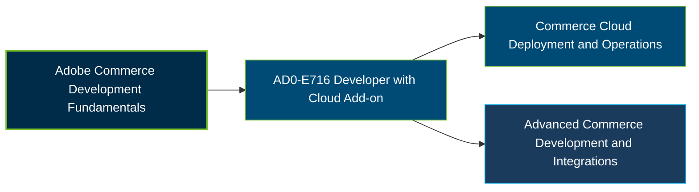

# Adobe Commerce Developer with Cloud Add-on Certification Exam Guide

A dedicated study guide and technical reference repository for candidates preparing for the **Adobe Commerce Developer with Cloud Add-on Certification Exam (AD0-E716)**.

---

## Exam Overview

The Adobe AD0-E716 certification exam focuses on development and customization of Adobe Commerce, including platform architecture, database operations, integrations, and Adobe Commerce Cloud capabilities.

- **Exam Format**: Online proctored examination.
- **Target Audience**: Adobe Commerce Developers, PHP Developers, Backend Engineers, and Commerce Cloud Developers.
- **Prerequisites**: No formal prerequisites publicly confirmed for this exam; practical Adobe Commerce development experience is recommended.

---

## Core Exam Domains & Knowledge Areas

### 1. Adobe Commerce Architecture & Development

- Commerce architecture, dependency injection, plugins, observers, and routing.
- Caching, configuration layers, Composer modifications, and custom extensions.
- Security practices, cron scheduling, and application performance.

### 2. Database, Admin & Commerce Customization

- Database schema changes, EAV attributes, and attribute sets.
- Admin grids, forms, store configuration, and UI components.
- Catalog, sales, shipping methods, and data import/export.

### 3. APIs, Integrations & Application Services

- Creating and extending APIs and managing application services.
- Queue systems, indexing, and data management.
- Integration testing and connections with external services.

### 4. Adobe Commerce Cloud Architecture & Operations

- Cloud project structure, permissions, and environment workflows.
- Cloud configuration, variables, branching, and CLI operations.
- Deployment, application services, logs, troubleshooting, and cloud maintenance.

---

## Certification Path

The following diagram presents a suggested learning progression, not an official Adobe certification pathway.

---

## Recommended Practice & Study Resources

To prepare effectively, combine official Adobe learning materials, technical documentation, and objective-based practice:

- **CertsGate**: Explore [Adobe AD0-E716 study materials and practice resources](https://certsgate.com/exams/adobe/ad0-e716) to review concepts, assess knowledge, and identify areas for further preparation.
- **Adobe Commerce Documentation**: Use the [Adobe Commerce Developer Documentation](https://developer.adobe.com/commerce/docs/) to study architecture, customization, APIs, database development, and Commerce Cloud implementation.
